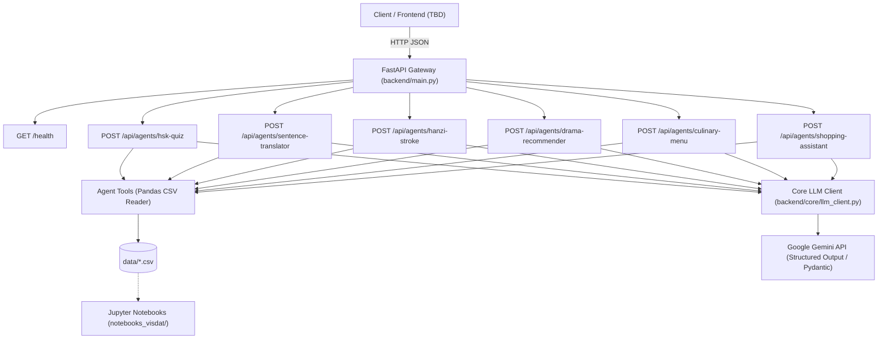

# Mandarin Ecosystem AI Hub

**Mandarin Ecosystem AI Hub** adalah platform ekosistem pembelajaran dan eksplorasi Bahasa Mandarin berbasis **6 AI Agent independen**. Setiap agent dikembangkan secara terpisah oleh satu anggota tim, memanfaatkan dataset CSV masing-masing menggunakan `pandas`, analisis EDA di Jupyter Notebook, serta pemrosesan LLM terstruktur (*Structured Output*) menggunakan **Gemini API (`google-genai`)** dan **Pydantic** di atas backend **FastAPI**.

---

## Arsitektur Sistem



---

## Pembagian Tugas 6 Anggota Tim

Setiap anggota tim bertanggung jawab penuh atas **1 folder agent**, **1 dataset CSV**, dan **1 notebook EDA** untuk meminimalkan konflik Git.

| No | Modul Agent | Peran Agent | Endpoint API | Dataset Wajib (`data/`) | Folder Agent (`backend/agents/`) | Notebook EDA (`notebooks_visdat/`) |
| :-: | :--- | :--- | :--- | :--- | :--- | :--- |
| 1 | `hsk_quiz` | HSK Flashcard & Quiz Agent | `POST /api/agents/hsk-quiz` | `01_hsk_vocabulary.csv` | `backend/agents/hsk_quiz/` | `01_eda_hsk_quiz.ipynb` |
| 2 | `sentence_translator` | Mandarin Sentence & Translator Agent | `POST /api/agents/sentence-translator` | `02_mandarin_sentences.csv` | `backend/agents/sentence_translator/` | `02_eda_sentence_translator.ipynb` |
| 3 | `hanzi_stroke` | Hanzi Stroke & Character Agent | `POST /api/agents/hanzi-stroke` | `03_hanzi_radicals_strokes.csv` | `backend/agents/hanzi_stroke/` | `03_eda_hanzi_stroke.ipynb` |
| 4 | `drama_recommender` | Chinese Drama & Movie Recommender Agent | `POST /api/agents/drama-recommender` | `04_chinese_dramas_movies.csv` | `backend/agents/drama_recommender/` | `04_eda_drama_recommender.ipynb` |
| 5 | `culinary_menu` | Chinese Culinary & Menu Agent | `POST /api/agents/culinary-menu` | `05_chinese_culinary_menu.csv` | `backend/agents/culinary_menu/` | `05_eda_culinary_menu.ipynb` |
| 6 | `shopping_assistant` | Mandarin Shopping Assistant Agent | `POST /api/agents/shopping-assistant` | `06_ecommerce_products.csv` | `backend/agents/shopping_assistant/` | `06_eda_shopping_assistant.ipynb` |

---

## Struktur Direktori

```text
.
├── .gitignore
├── .env.example
├── README.md
├── requirements.txt
├── data/
│   └── README.md
├── notebooks_visdat/
│   ├── 01_eda_hsk_quiz.ipynb
│   ├── 02_eda_sentence_translator.ipynb
│   ├── 03_eda_hanzi_stroke.ipynb
│   ├── 04_eda_drama_recommender.ipynb
│   ├── 05_eda_culinary_menu.ipynb
│   └── 06_eda_shopping_assistant.ipynb
├── backend/
│   ├── __init__.py
│   ├── main.py
│   ├── core/
│   │   ├── __init__.py
│   │   ├── config.py
│   │   ├── llm_client.py
│   │   └── schemas.py
│   └── agents/
│       ├── __init__.py
│       ├── hsk_quiz/
│       ├── sentence_translator/
│       ├── hanzi_stroke/
│       ├── drama_recommender/
│       ├── culinary_menu/
│       └── shopping_assistant/
└── frontend/
    └── README.md
```

---

## Cara Setup Lokal

### 1. Clone Repositori
```bash
git clone <url-repositori-tim>
cd All-About-Mandarin-Agentic
```

### 2. Buat & Aktifkan Virtual Environment (`venv`)
**Windows (PowerShell):**
```powershell
python -m venv .venv
.\.venv\Scripts\Activate.ps1
```

**macOS / Linux:**
```bash
python3 -m venv .venv
source .venv/bin/activate
```

### 3. Install Dependencies
```bash
pip install -r requirements.txt
```

### 4. Konfigurasi Environment Variable
Salin `.env.example` menjadi `.env`, lalu isi `GEMINI_API_KEY` Anda:

**Windows (PowerShell):**
```powershell
Copy-Item .env.example .env
```

**macOS / Linux:**
```bash
cp .env.example .env
```

Edit `.env`:
```env
GEMINI_API_KEY=isi_api_key_gemini_anda
GEMINI_MODEL=gemini-2.5-flash
DATA_DIR=data
```

### 5. Letakkan Dataset CSV
Unduh dataset masing-masing dan simpan ke folder `data/` sesuai penamaan persis pada [data/README.md](data/README.md). File CSV di folder `data/` otomatis diabaikan oleh `.gitignore`.

### 6. Jalankan Backend FastAPI
Jalankan perintah berikut dari **root direktori proyek**:
```bash
uvicorn backend.main:app --reload
```

Buka dokumentasi interaktif Swagger UI di browser:
- Health Check: `http://127.0.0.1:8000/health`
- Swagger Docs: `http://127.0.0.1:8000/docs`

### 7. Jalankan Jupyter Notebook untuk EDA
```bash
jupyter notebook notebooks_visdat/
```

---

## Kontrak API Standar

Semua 6 endpoint agent menerima request JSON (`AgentRequest`) dan mengembalikan response terstruktur (`AgentResponse`):

**Request (`POST /api/agents/<nama-agent>`):**
```json
{
  "user_input": "Buatkan 1 soal kuis kosakata HSK 1 tentang makanan",
  "filters": {
    "level": "HSK 1"
  }
}
```

**Response:**
```json
{
  "agent_name": "hsk_quiz",
  "mandarin_text": "...",
  "pinyin": "...",
  "translation": "...",
  "explanation": "...",
  "recommended_items": []
}
```

---

## Aturan Git Workflow (Bebas Konflik Tim 6 Orang)

Untuk menjaga repositori tetap bersih dan bebas *merge conflict*:

1. **Jangan push langsung ke `main`.** Selalu buat branch baru sesuai modul masing-masing:
   ```bash
   git checkout main
   git pull origin main
   git checkout -b feat/hsk-quiz
   ```
2. **Isolasi Area Kerja:** Setiap anggota **HANYA** boleh mengubah file di dalam:
   - `backend/agents/<nama_agent>/` (`agent.py`, `prompts.py`, `tools.py`)
   - `notebooks_visdat/0X_eda_<nama_agent>.ipynb`
3. **File Bersama (`backend/main.py`, `backend/core/*`, `requirements.txt`):**
   - Jangan ubah file bersama tanpa koordinasi/persetujuan seluruh tim melalui Pull Request terpisah.
   - Pastikan fungsi `run(request: AgentRequest) -> AgentResponse` di `agent.py` selalu mempertahankan *signature* standar.
4. **Dilarang Commit File Rahasia & Data Besar:**
   - Jangan pernah men-commit file `.env` atau file `.csv` mentah (sudah diatur di `.gitignore`).
5. **Pull Request & Review:**
   - Pastikan server `uvicorn backend.main:app --reload` berjalan tanpa `ImportError` dan endpoint agent Anda merespons dengan baik sebelum membuat Pull Request ke `main`.
